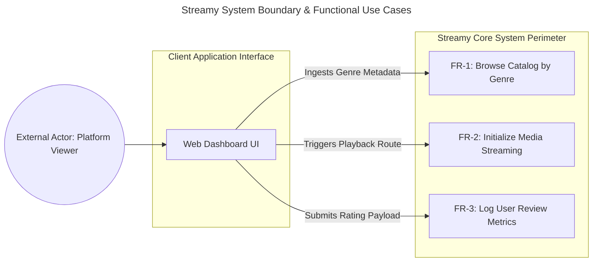
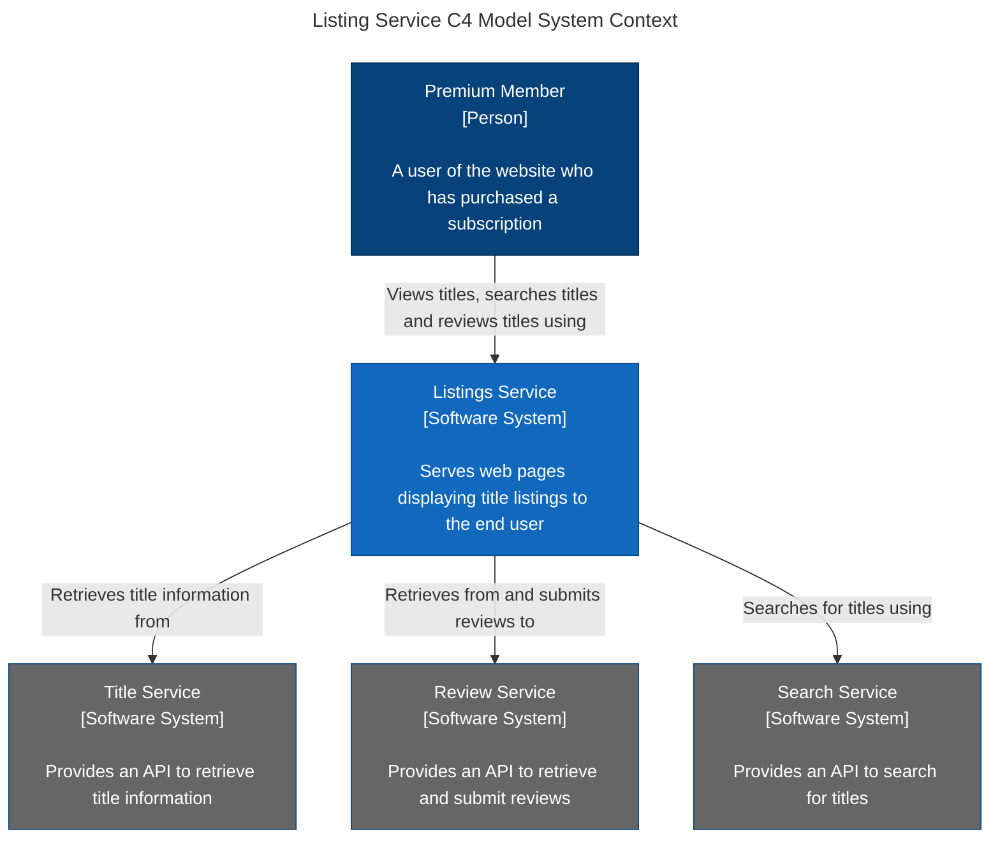
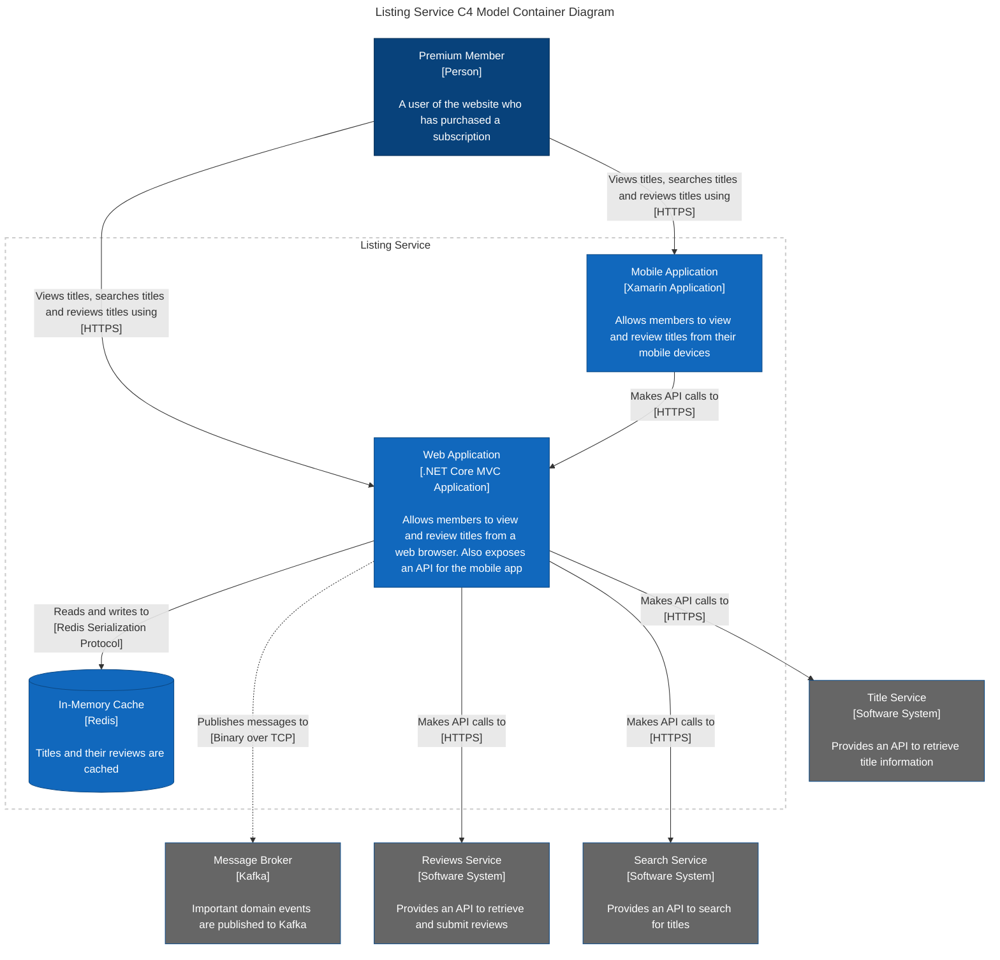
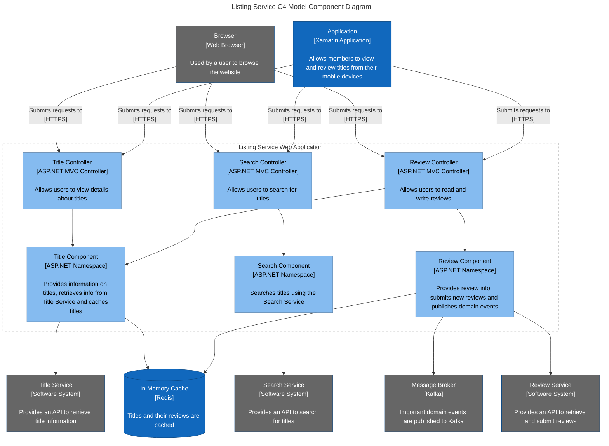

# Software Requirements Specification (SRS)
## Project Baseline: Streamy Video Streaming Core Engine

### 1. Functional Requirements (FR)
The Streamy core processing layer must execute the following functional automation features:

* **FR-1:** The system must process an individual media catalog database searchable by categorical Genre taxonomies.
* **FR-2:** The system must handle multi-season episodic indexing structures for mapped TV Show entities.
* **FR-3:** The system must allow users to log numerical and text-based Review metrics against media elements.
* **FR-4:** The system must track viewer consumption metrics for metadata analytics extraction.
* **FR-5:** The system must support data serialization schemas for media item state inheritance.

### 2. Non-Functional Requirements (NFR)
The application architecture is constrained by the following systemic performance parameters:

* **NFR-1 (Runtime Environment):** The final functional system must compile exclusively inside a pure Python 3.x execution environment.
* **NFR-2 (Maintainability Paradigm):** All system design schematics, relationship maps, and entity models must render natively inline via plain-text syntax.
* **NFR-3 (Data Integrity):** The underlying database must enforce cascading deletion operations across nested entity constraints.

### 3. Functional System Boundary Diagram
The diagram below plots the structural use-case interactions crossing the Streamy application boundaries:

## 4. C4 Architecture Model: System Context
The following high-level C4 System Context diagram illustrates the core Listing Service and its interactions with external supporting microservices.

## 5. C4 Architecture Model: Container Diagram
The following C4 Container Diagram details the deployable system units, protocols, in-memory caches, and downstream supporting microservices.

## 6. C4 Architecture Model: Component Diagram
The following C4 Component Diagram zooms into the Listing Service Web Application container to detail its internal controllers, business components, and external system dependencies.

