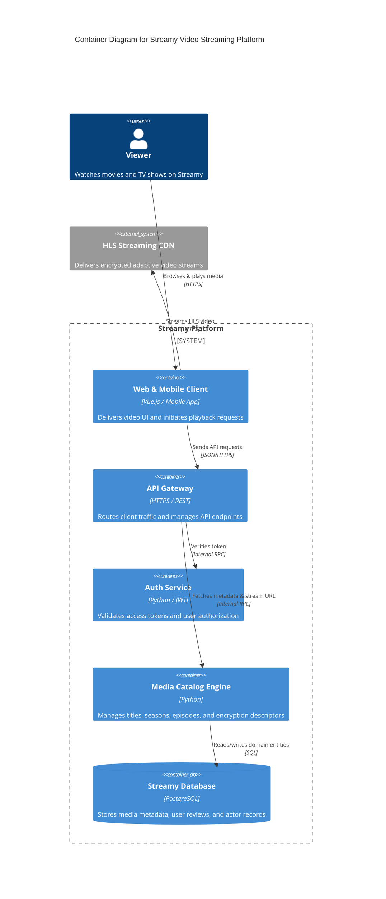

# Streamy System Architecture (C4 Container Model)

This document illustrates the container-level architecture of the **Streamy** video streaming platform, automatically compiled from Mermaid markup via GitHub Actions.

## C4 Container Diagram

