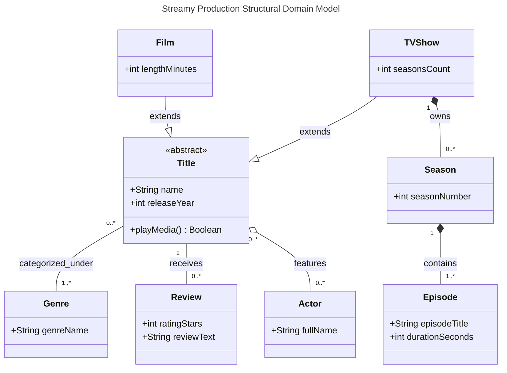
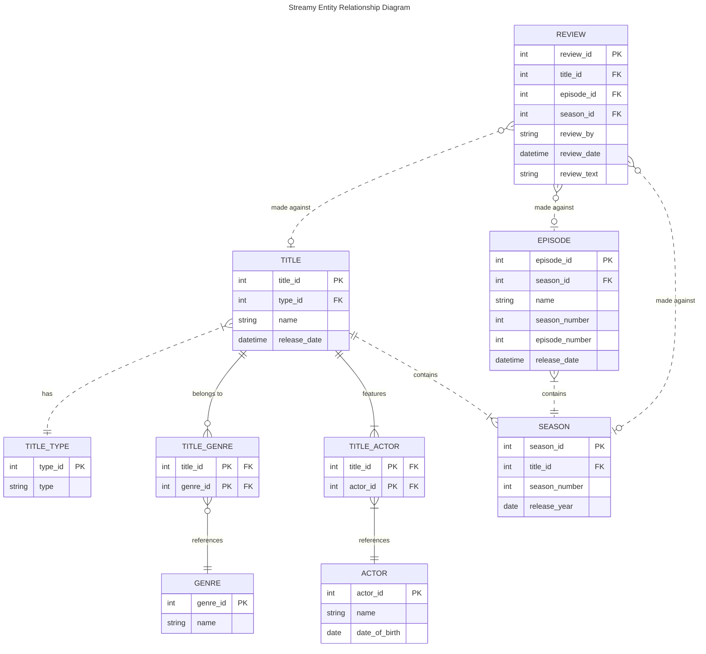

# Streamy Core Domain Structural Architecture
## Advanced Object-Oriented System Entity Specifications
### 1. Complex System Relationships Analysis
This structural document acts as the definitive blueprint for the Streamy runtime
system. It establishes core hierarchies, lifecycle coupling, and cardinality rules,
dictating how object models must inherit attributes and clear space allocations out
of memory.
### 2. Comprehensive Production Class Diagram
The advanced structural design schematic below details all inheritance, composition,
and aggregation parameters for the Streamy domain engine:

class Film {
    +int lengthMinutes
}
class TVShow {
    +int seasonsCount
}
class Sea
## 3. Relational Database Schema (ERD)
The following Entity Relationship Diagram specifies the relational database schema, mapping primary/foreign keys, cardinalities, and identifying vs non-identifying entity associations:

