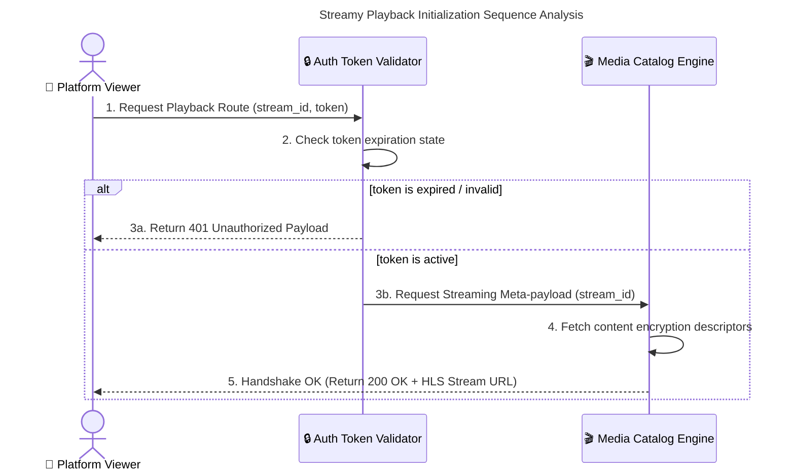
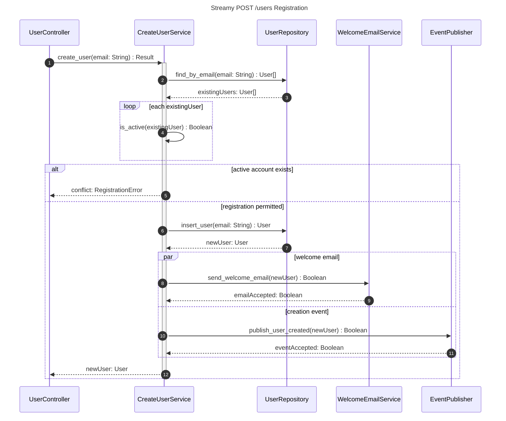

# Streamy Backend Dynamic Behavioral Modeling
## System Architecture Interaction Streams

### 1. Architectural Core Mechanics
This tracking document details how application payloads pass between data layers before structural code layers are compiled. By designing how inputs move through software boundaries beforehand, we ensure development velocity remains high.

### 2. Media Playback Transaction Loop
The sequence model below outlines how the system validates viewer access permissions before initiating video file playback:

### 3. Advanced Code Flow: User Registration
The following sequence diagram models the code-level interactions for a user registration request. It demonstrates loops for validation, alternative branches for conflict handling, and parallel execution blocks for asynchronous tasks like email notification and event publishing.

